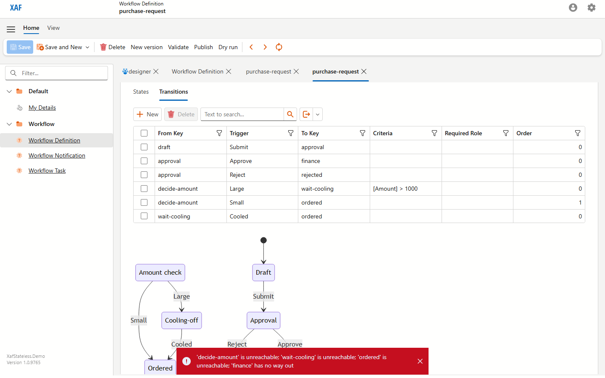
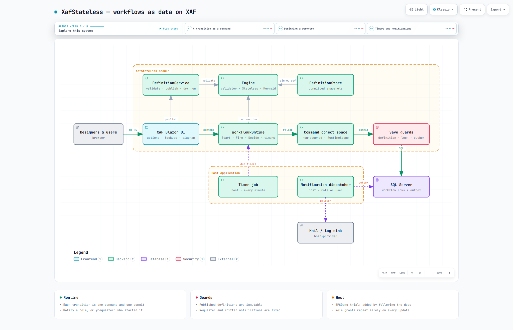
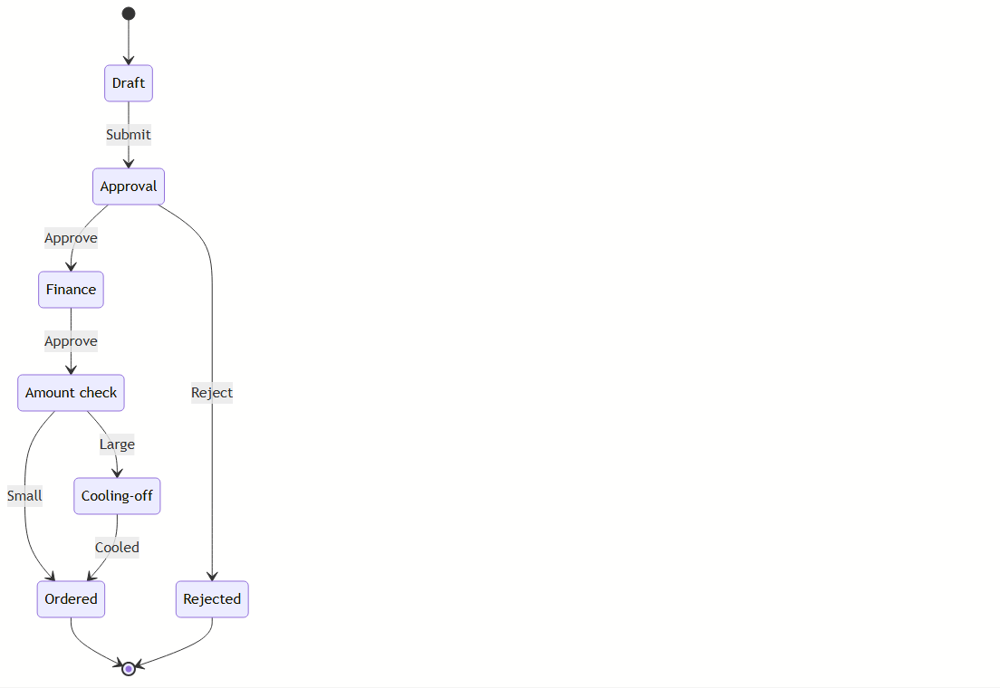
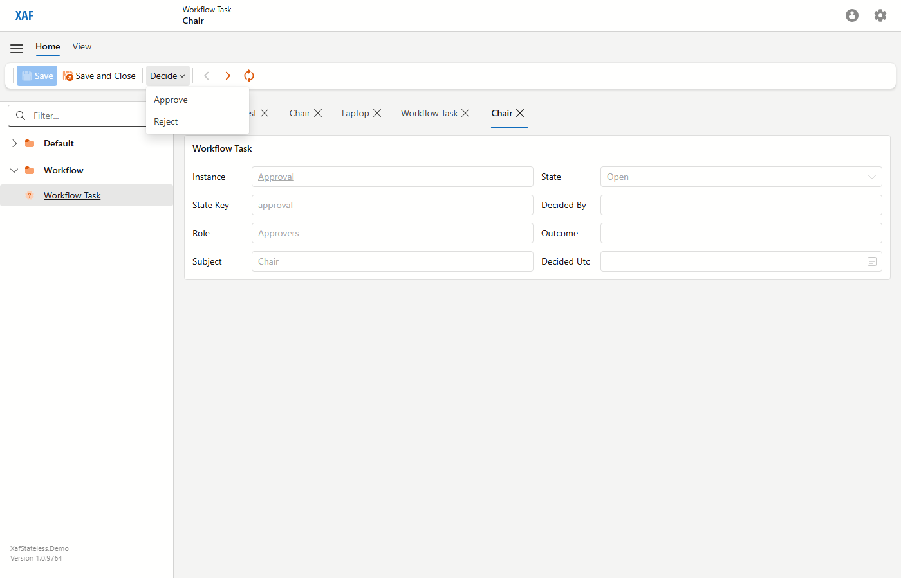
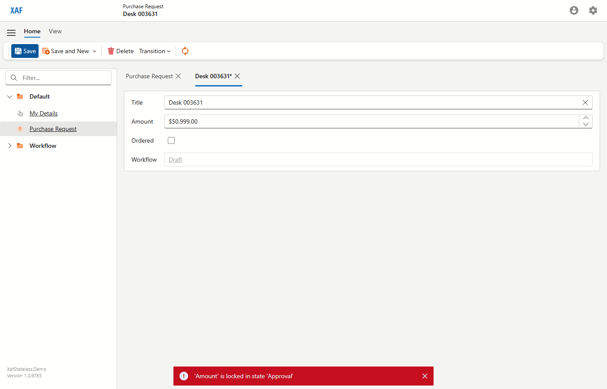
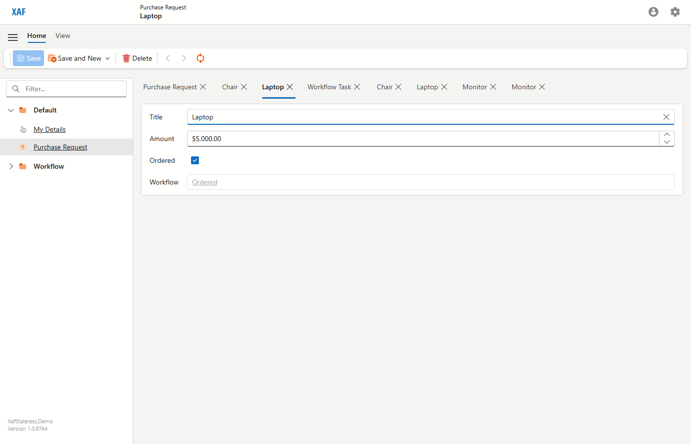

# XafStateless

End users define workflows as data in a DevExpress XAF app. They add states, draw transitions and choose what each
state does from a small set of step types (a human task, a timed wait, an automatic decision, a notification, setting a
field), without a developer or a deployment. Definitions are **versioned**: a draft is edited and **validated before
publish**, and running work stays on the version it started on. The published definition runs on the
[Stateless](https://github.com/dotnet-state-machine/stateless) state-machine library. **Fields can be locked per
state**, in the UI and again at save. The **diagram is generated from the same definition** that runs, so the picture
cannot drift from the behaviour.



## Compared with XAF's StateMachine module

XAF's built-in StateMachine module was checked against dxdocs pages 113713, 113714 and 113715.

| | XAF StateMachine | XafStateless |
|---|---|---|
| Who defines states | Runtime rows, but each state is a *marker value* of an enum or reference property on the class | End users, as rows keyed by a string. No enum and no code change |
| What a state *does* | Nothing: transitions are toolbar Actions plus Conditional Appearance | A fixed set of step types that users configure and developers extend |
| Waiting / timers | None | The Wait step, fired by a per-minute runner |
| Human tasks | None | The Task step, whose outcomes are the outgoing triggers |
| Safe editing | Edits apply live to running objects | Draft → Published → Retired; running work stays pinned to its version |
| Validation | None | At publish: reachability, a way out, no stuck wait, no automatic loop, and criteria, role and field checks |
| Lock fields per state | Yes: `StateAppearance`, UI only | Yes: locked in the UI and refused at save |
| Diagram | None | Mermaid, generated from the definition that runs |

## Architecture

[](docs/architecture/xafstateless-architecture.html)

There are three layers:
- `XafStateless.Engine` is pure .NET and depends only on Stateless. It holds the definition records, the validator, the
  machine builder, the dry run and the Mermaid export.
- `XafStateless.Module` is the XAF / EF Core module. It holds:
  - the entities;
  - the guards: immutability, and runtime-owned rows and field locks;
  - the publish lifecycle;
  - the runtime: start, fire, decide, timers and effects;
  - the controllers.
- `XafStateless.Blazor` holds the lookup editors and the diagram.

`demo/` is a small XAF Blazor host. Open the linked HTML for the interactive version of the diagram above, with light
and dark themes.

## Screenshots

| | |
|---|---|
|  |  |
| The diagram of v2, after the designer added the Finance step | A human task: the outcomes are the state's outgoing triggers |
|  |  |
| Amount is locked in Approval: an edit that races the transition is refused at save | A 5,000 request went through the Cooling-off wait by itself; the Set field step checked Ordered |

More screenshots are in [`docs/screenshots/`](docs/screenshots/).

## Status

Proof of concept, feature-complete for the demo:
- the engine, validator, dry run and Mermaid export;
- versioned definitions with publish-time validation;
- the runtime, with Task, Wait, Decision, Notify and Set field steps;
- per-state field locks;
- the permission matrix;
- the diagram.

Coverage:
- Engine and module: unit and LocalDB tests (`dotnet test XafStateless.slnx`).
- The designer journey: one end-to-end Playwright test against the running demo (`tests/XafStateless.E2E`). It creates
  v2 with a new Finance step, is refused at publish until the step has a way out, and shows that a v2 request passes
  Finance while a v1 request started earlier does not.

Next: a trial integration into a real host application, following [docs/integrating.md](docs/integrating.md). There is
no NuGet package yet. Open work lives on ContextBoard, project **XafStateless**.

## How to run

Requirements: Windows, the .NET 10 SDK, SQL Server LocalDB (`(localdb)\mssqllocaldb`), and DevExpress 26.1.4 packages
on the NuGet feed.

```powershell
cd C:\Projects\XafStateless
dotnet build XafStateless.slnx

cd C:\Projects\XafStateless\demo\XafStateless.Demo.Blazor.Server\bin\Debug\net10.0
# first run only: create and seed the XafStatelessDemo database
.\XafStateless.Demo.Blazor.Server.exe --updateDatabase --forceUpdate --silent --environment Development
.\XafStateless.Demo.Blazor.Server.exe --urls http://localhost:5000 --environment Development
```

Open http://localhost:5000. The seeded users all have empty passwords:

| User | Role | Try |
|---|---|---|
| `designer` | WorkflowDesigners | Workflow > Workflow Definition > purchase-request > **New version**, edit, **Validate**, **Publish**, **Dry run** |
| `approver` | Approvers | Purchase Request > New > **Start workflow** > **Transition** Submit; Workflow Task > **Decide** |
| `Admin` | Administrators | all data and the designer actions (holds no Approvers role, so no tasks to decide) |

The seeded `purchase-request` v1 runs Draft → Approval (a task for Approvers; Amount locked) → Amount check → Ordered.
Amounts over 1000 go through a one-minute Cooling-off wait first.

To start over, drop the database, then rerun the `--updateDatabase` line:

```powershell
sqlcmd -S "(localdb)\mssqllocaldb" -Q "ALTER DATABASE XafStatelessDemo SET SINGLE_USER WITH ROLLBACK IMMEDIATE; DROP DATABASE XafStatelessDemo"
```

### Tests

```powershell
cd C:\Projects\XafStateless
dotnet test XafStateless.slnx                  # engine + module (LocalDB)

# E2E: needs a freshly seeded database and the demo running on http://localhost:5000 (see above)
dotnet build tests\XafStateless.E2E
powershell -File tests\XafStateless.E2E\bin\Debug\net10.0\playwright.ps1 install chromium   # once
dotnet test tests\XafStateless.E2E
```

The E2E test is not part of the solution, so `dotnet test XafStateless.slnx` runs without the demo. It writes a
screenshot per step to `tests/XafStateless.E2E/screenshots/` (gitignored). The base URL and user names are in
`tests/XafStateless.E2E/appsettings.e2e.json`.

## Using it in your own app

See **[docs/integrating.md](docs/integrating.md)**. It covers:
- the module references;
- the DbContext: DbSets, `UseOptimisticLock()`, and the two guards;
- `AddXafStateless()` and the Mermaid script tags;
- role seeding and subject classes;
- the timer and notification delivery;
- the limits.
