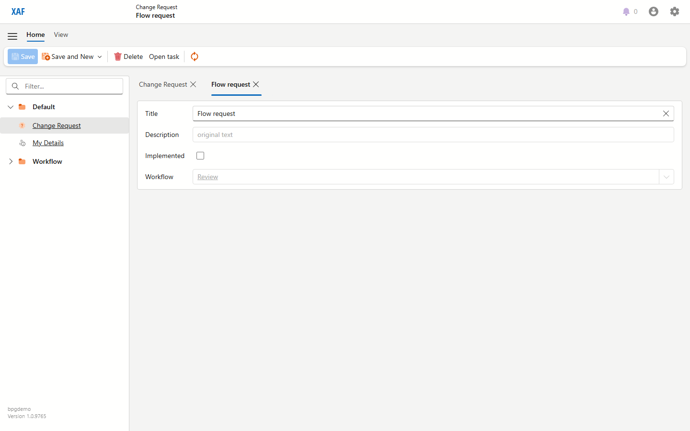
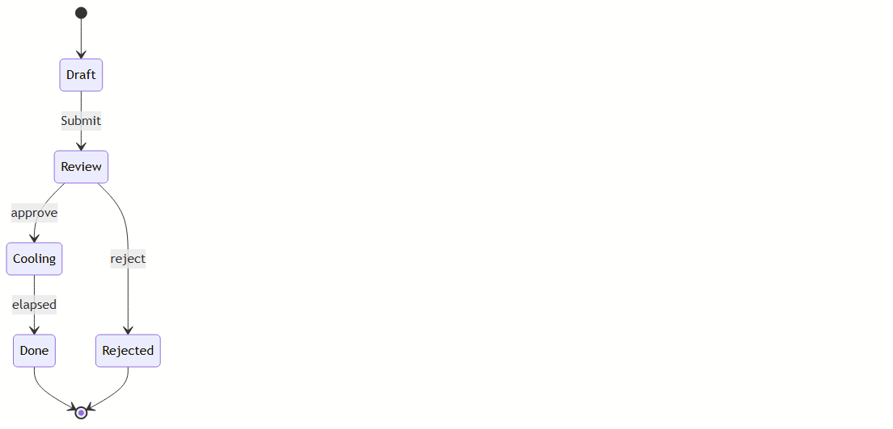

# Host trial: XafStateless in the BPGDemo skeleton

**Result: the module drops into BPGDemo by following `docs/integrating.md`, with four doc gaps (now fixed) and no module
change.** The guards hold for UI and Web API writes alike. Timers and notifications run as Hangfire jobs through the
skeleton's own job framework. Two findings matter for BPG before the module goes into generated apps for real: workflow
writes bypass the skeleton's automation hooks, and adding a job to the skeleton takes two new files plus five plumbing
edits across four existing ones.

Plan: `docs/superpowers/plans/2026-09-26-bpgdemo-trial.md`. Cards: XSM-015 (wiring), XSM-016 (subject, flow, API,
hooks), XSM-017 (jobs), XSM-010 (this report). Carried out 2026-09-26.

## Setup

| | |
|---|---|
| Revisions | BPGDemo `83f3a98` (master), XafStateless `da61a65`, BPG `1246a00` |
| Trial branch | `trial/xafstateless` in worktree `C:\Projects\BPGDemo.trial`: `d5b1f93` (XSM-015), `e804d3c` (XSM-016), `b63164f` (XSM-017). Local, not pushed. |
| Why a worktree | BPG copies `C:\Projects\BPGDemo` as its skeleton (`XAF:SkeletonProjectPath`). The main tree stayed on `master` throughout. |
| Database | `(localdb)\mssqllocaldb`, catalog `bpgdemoTrial`, set in the trial's `appsettings.Development.json` |
| Run | exe from `bpgdemo.Blazor.Server\bin\Debug\net10.0`, always `--environment Development` (the exe ignores launch profiles; without it the host updates the `bpgdemo` catalog). The `bpgdemo.mdf` timestamp stayed unchanged through every run. |
| Packages | No downgrade or conflict warnings. Resolved: Microsoft.Data.SqlClient 6.1.2, EF Core + SqlServer 10.0.10, DevExpress.ExpressApp 26.1.4, Hangfire 1.8.25, MailKit 4.18.0, Stateless 5.20.1 |
| Tests | bpgdemo.Jobs.Tests 47/47; XafStateless Engine 37, Module 95, the same as before the trial (the trial changed no module code) |

## Touch points

`git diff --stat master..trial/xafstateless`: 16 files, 178 lines added, none removed.

**Module integration (XSM-015 + XSM-016), 10 files, 83 lines:**

| File | Lines | What |
|---|---|---|
| `bpgdemo.Module/bpgdemo.Module.csproj` | 1 | ProjectReference to XafStateless.Module |
| `bpgdemo.Module/Module.cs` | 1 | `RequiredModuleTypes.Add(XafStatelessModule)` |
| `bpgdemo.Module/BusinessObjects/bpgdemoDbContext.cs` | 21 | usings, 7 DbSets + subject DbSet, `ConfigureXafStateless()`, `OnConfiguring` with both guards |
| `bpgdemo.Blazor.Server/bpgdemo.Blazor.Server.csproj` | 1 | ProjectReference to XafStateless.Blazor |
| `bpgdemo.Blazor.Server/BlazorModule.cs` | 1 | `RequiredModuleTypes.Add(XafStatelessBlazorModule)` |
| `bpgdemo.Blazor.Server/Startup.cs` | 3 of 5 | `AddXafStateless()`, Web API `BusinessObject<ChangeRequest>()` |
| `bpgdemo.Blazor.Server/Pages/_Host.cshtml` | 2 | Mermaid + diagram script tags |
| `bpgdemo.Module/BusinessObjects/ChangeRequest.cs` | 16 | the trial's subject class (the skeleton has none of its own) |
| `bpgdemo.Module/DatabaseUpdate/Updater.cs` | 34 of 43 | Approvers/WorkflowDesigners roles, `designer`/`approver` demo users |
| `bpgdemo.Blazor.Server/appsettings.Development.json` | 3 of 6 | trial catalog (trial-only) |

**Skeleton job plumbing (XSM-017), 9 files, 95 lines** (three of them shared with the list above: `Startup.cs`, `Updater.cs`, `appsettings.Development.json`): two command records, two handlers,
two `AddJobHandler` lines, four `case`s in `JobDispatchService` (two switches), two `CommandMetadataProvider` entries,
two seeded `JobDefinition`s, `Jobs:UseHangfire = true` for the trial.

## Doc bugs fixed in `docs/integrating.md`

1. §3 and §4 did not name the namespaces. `ConfigureXafStateless()` and `AddXafStateless()` are extension methods in
   `XafStateless.Module`; without `using XafStateless.Module;` neither compiles. Now listed in both sections.
2. §3: the `OnConfiguring` override triggers DevExpress analyzer **XAF0031** ("Add the UseChangeTrackingProxies()
   call"). It is a false positive for this override: `UseConnectionString` in the host's `WithDbContext` already enables
   the proxies (DevExpress docs, "Change Tracking in EF Core DbContext"), and the override only adds interceptors. §3 now
   shows the pragma and explains when a host does need `UseChangeTrackingProxies()`. The demo had the same warning; its
   `DemoDbContext` now carries the same pragma.
3. §7 did not say where `IWorkflowSubject` and `WorkflowInstance` live (`XafStateless.Module.BusinessObjects`).
4. §7: `WorkflowInstance?` raises CS8632 in a project without nullable enabled, which is the XAF template default and
   the skeleton's setting. §7 now says to add `#nullable enable` or drop the `?`.
5. §7 had no Web API step. The skeleton's Web API exposes only registered types, so `options.BusinessObject<ChangeRequest>()`
   was needed; §7 now has it as an optional step, with what the guards return.

Plus a pointer from §8 to this report for a host with a command/handler job framework. §1, §2, §5, §8 and §9 worked as
written; §6 worked for newly created roles.

Found by the Codex review of this report, read in code, not tried on a host (both trial hosts already satisfied them):

6. §3 did not list `UseDeferredDeletion(this)` as a requirement, although the module's index filters and `DefinitionGuard`
   read `GCRecord`, which only deferred deletion maps. Now required in §3.
7. §6: `CreateRole` skips the grants when a role with that name already exists, so a host with an existing `Approvers`
   role, or a second subject added later, silently gets no workflow grants. §6 now says so; an idempotent grant helper is
   XSM-021.

## What was verified

**Schema on an existing database (XSM-015).** The untouched skeleton was seeded first (3 users, 3 roles, a marker
`JobDefinition`). Adding the module and updating created the 7 workflow tables and the 4 filtered unique indexes from
`ModelBuilderExtensions` (each filtered on `[GCRecord]=(0)`); users and the marker row survived. A dropped and rebuilt
catalog gives the same tables and indexes; a second update on a populated catalog exits 0.

**The flow (XSM-016).** `designer` built and published ChangeFlow (Draft → Review [Task, Approvers, Description locked]
→ Done [Set field Implemented = true] / Rejected). `approver` started a request, submitted it, found Description read-only
in Review, approved it: Done, Implemented = 1.

**Web API (XSM-016).** With an `approver` token: GET 200 and a PATCH on a request not started 204 (the positive
controls). On a request in Review: PATCH Description → 400 `'Description' is locked in state 'Review'`; DELETE → 400
`'Request B' cannot be deleted while its workflow is in 'Review'`. The row was unchanged in the database.

**Timer and notification on Hangfire (XSM-017).** ChangeFlow v1 adds a one-minute Wait ("Cooling") after approve and a
Notify to Approvers on Done. JobSyncService registered both recurring jobs with no "unknown job type" warning. Request D
(instance `3D055CE0-6CA7-4D22-5741-08DF1BCF82C0`) entered Cooling at 13:10:22Z, due 13:11:22Z, and reached Done at
13:12:13Z. The timer handler logged `running as HangfireJob` then `1 fired` (Hangfire job 10). Notification
`1C5670B1-28C9-4979-D447-08DF1BCFC7DA`: Sent, Attempts 1, one log line (job 11), none on the next run. Both
JobDefinitions: LastRunStatus Success, 6/6 linked runs successful.

The trial's dispatcher marks the batch Sent, commits, and only then logs, so a failed commit is never logged as sent. For
a log sink that is at-most-once: a crash between the commit and the log line loses the line. A real dispatcher must
follow §9 instead (deliver, then record the outcome per row). The trial proves the outbox path, not delivery to a person
or recovery after a failure. The `BackgroundJobs` role is unchanged (its 3 read
grants): the timer needs no workflow permissions because it runs as the system over a non-secured space.

More screenshots: `images/host-trial/` (definition list, v0 diagram, request Done, Hangfire recurring jobs, request D Done).

## Friction

| Friction | Fix | Module change? |
|---|---|---|
| Four doc gaps (above) | Fixed in `integrating.md` | No |
| XAF0031 on the override | Pragma + explanation in §3 | No |
| No NuGet package: the host references this repo by relative path | Pack like XafLayoutBuilder once adopted | Packaging only |
| Adding a job to the skeleton: command, handler, `AddJobHandler`, two dispatch switches, metadata, and a seed whose Name must equal the command type name | bpg JOBS-001 | No (skeleton) |
| The subject needs `IWorkflowSubject` + a `Workflow` property in its source | For generated apps BPG would emit both | No |
| Tabs persist per user across logons, which made scripted re-runs flaky | bpg CARD-1825 (second sighting added) | No (skeleton) |

## Findings, each on a card

| Finding | Status | Card |
|---|---|---|
| Workflow Set-field writes bypass the skeleton's automation hooks. A scratch probe on both hook paths saw a UI edit (positive control) and the API PATCHes, but not the runtime's commit that set `Implemented`, although the database had it. The runtime uses `INonSecuredObjectSpaceFactory`; the skeleton announces only `IObjectSpaceFactory` spaces. | Bypass observed; effect on a real generated rule or webhook **unverified** | bpg WF-007 |
| The generated "Webhook outbox" JobDefinition's Name differs from its command name, so by the recorder's Name lookup its LastRunStatus would never update. The trial showed the mechanism the other way round (Name = command name links). | **Unverified**, read in code only | bpg AUTO-003 |
| Skeleton users have no e-mail address, so the dispatcher can only log. A real dispatcher needs a user→address source. | Observed | XSM-014 (requester notification) is the place to settle it |
| A brand-new definition publishes as Version 0; New version makes 1 | Observed, not yet reproduced by a test | XSM-018 |
| The effect detail view's Kind/Target combos and Order spin have no accessible names (the state view's do) | Observed | XSM-019 |
| The module's navigation items show XAF's "?" placeholder icon; the effect-kind caption reads "Set field" | Observed, cosmetic | XSM-020 |

## Putting it in the skeleton for real

The trial branch is a proof, not a merge candidate. Adoption would need:

1. **A NuGet package** for XafStateless.Module and .Blazor, published to the local feed like XafLayoutBuilder, instead
   of the relative ProjectReference.
2. **A decision on WF-007**: announce the runtime's object spaces to the automation hooks, or document that workflow
   effects never trigger automation rules and webhooks.
3. **The BPG side**: BPG regenerates the DbContext's DbSets and the updater for each app, so the generator has to emit
   the workflow DbSets, `ConfigureXafStateless()`, the guard override and the role seeding, plus `IWorkflowSubject` on
   the classes the spec marks as workflow subjects. The two jobs belong in the skeleton itself (ideally after JOBS-001).
4. **The BPG gates**: any skeleton change runs `GenerationPipelineTests` (BPG's E2E gate), and skeleton-only work gets a
   bpg card closed against the BPGDemo SHAs.
5. **Overlap with bpg WF-004/005/006** (Stateless-based skeleton workflow pieces generated from the spec): decide whether
   XafStateless replaces that approach or sits next to it. That is the "BPG generates workflows" question, deliberately
   left out of this trial.
